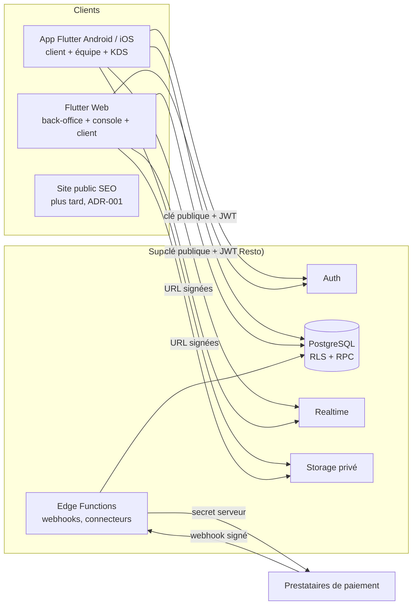

# Resto — Architecture

## 1. Vue d'ensemble



- **Source de vérité unique** : PostgreSQL. Toute règle métier critique
  (montants, statuts, stocks, droits) est contrôlée en base (contraintes,
  déclencheurs, fonctions RPC `security definer`).
- **Client** : Flutter, une seule base de code pour Android, iOS et Web.
- **Secrets** : uniquement dans les secrets Supabase (Edge Functions) ou le
  Vault ; jamais dans l'application.

## 2. Décisions d'architecture (ADR)

### ADR-001 — Flutter unique pour toutes les interfaces applicatives

*Contexte* : le cahier des charges cite Next.js pour le web de gestion et la
console, « à confirmer après audit ». Node n'est pas installé ; les
applications existantes de l'utilisateur (Immo, Néo) utilisent Flutter Web
avec succès ; la règle de parité impose que tout fonctionne à l'identique sur
mobile et web.

*Décision* : back-office, KDS, caisse, console plateforme et espace client
sont développés en **Flutter** (mobile + web). Une seule logique métier
cliente, un seul jeu de traductions, une seule série de tests.

*Conséquence* : Flutter Web est peu référençable. Si le référencement des
pages publiques (fiches restaurants, menus) devient un objectif, un **site
public Next.js en lecture seule** sera ajouté en Phase 4, consommant les mêmes
vues publiques. *À confirmer par l'utilisateur.*

### ADR-002 — Montants en unités mineures entières

`amount_minor bigint` + `currency char(3)` (ISO 4217). Le nombre de
décimales vient de `currencies.minor_unit` (0 pour XAF/JPY, 2 pour EUR, 3 pour
KWD/TND…). Côté Dart : classe `Money` (entier). Sur le Web, les entiers Dart
sont des nombres JS : sûrs jusqu'à 2^53 − 1 ; `Money` refuse tout dépassement
(≈ 90 000 milliards en monnaie à 2 décimales, largement suffisant). Taux de
taxe et de commission : `numeric` en base, entiers mis à l'échelle en Dart ;
arrondi selon la règle de la juridiction, calcul de référence côté serveur.

### ADR-003 — Multi-locataire par `organization_id` + clés étrangères composites

Chaque ligne métier porte `organization_id`. Les relations internes utilisent
des clés composites `(organization_id, id)` : il est **physiquement
impossible** de rattacher un objet à un parent d'une autre organisation, même
en cas d'erreur de politique RLS.

### ADR-004 — Droits par permissions, pas par noms de rôles

Les politiques RLS testent des **permissions** (`orders.write`,
`cash.close`…) via des fonctions qui renvoient l'ensemble des organisations /
établissements autorisés, évaluées une fois par requête
(`branch_id in (select app_private.branches_with('orders.read'))`). Les rôles
sont des paquets de permissions ; des rôles personnalisés pourront être
ajoutés sans toucher aux politiques.

### ADR-005 — Écritures sensibles par RPC uniquement

Commandes validées, paiements, caisse, stocks, achats, abonnements : pas
d'`insert/update` direct depuis le client. Les RPC sont atomiques, vérifient
les droits, valident les données, posent les verrous nécessaires, écrivent
l'audit, et acceptent une **clé d'idempotence**.

### ADR-006 — Identifiants UUID générables hors ligne

Les identifiants sont des UUID ; le client peut les fournir (création hors
ligne). L'unicité d'un événement de synchronisation est garantie par
`(device_id, client_event_id)` ; voir [OFFLINE_SYNC.md](OFFLINE_SYNC.md).

### ADR-007 — Migrations SQL versionnées collées dans Supabase

Pas de CLI sur le poste : `supabase/migrations/NNN_nom.sql`, idempotentes
quand c'est possible, jamais modifiées une fois appliquées (on ajoute la
suivante). Chaque migration a son script de contrôle dans `supabase/tests/`.

## 3. Organisation du code Flutter

```
lib/
  main.dart            démarrage, Supabase, thème, langues
  config/env.dart      URL + clé publique (dart-define), jamais de secret
  core/                logique pure testable (Money, arrondis, règles)
  data/                accès Supabase (RPC, requêtes), modèles
  features/<domaine>/  écrans et état par domaine (org, menus, orders…)
  l10n/                fichiers ARB (fr source) + code généré
  ui/                  thème, composants communs, mise en page responsive
```

Pas de framework d'état lourd au départ : `ChangeNotifier` / `ValueNotifier`
et services injectés. Une dépendance n'est ajoutée qu'avec un besoin réel.

## 4. Environnements

| Env | Supabase | Données | Fichier |
|---|---|---|---|
| development | projet « resto-dev » | fictives uniquement | `env/dev.json` |
| staging | projet « resto-staging » | fictives, recette | `env/staging.json` |
| production | projet « resto » | réelles | `env/prod.json` |

Les fichiers `env/*.json` sont exclus de Git (`env/example.json` seul suivi).
Au démarrage, l'application affiche un bandeau si `APP_ENV` ≠ production.

## 5. Temps réel, impression, notifications

- Realtime Supabase sur les tables de commandes / tickets KDS, filtré par
  établissement, soumis à la RLS.
- Impression : Phase 6 (ESC/POS réseau ou Bluetooth selon matériel ; PDF
  pour le Web).
- Notifications push : Phase 4 (FCM / APNs via Edge Function).

## 6. Paiements

Interface de connecteur côté serveur (Edge Function) : `createIntent`,
`handleWebhook` (signature vérifiée), `refund`, `fetchSettlement`. Chaque
prestataire est un module ; activation par pays et par établissement. Voir
[SECURITY.md](SECURITY.md) §7. Aucun connecteur n'est déclaré disponible sans
compte de test réel validé.
