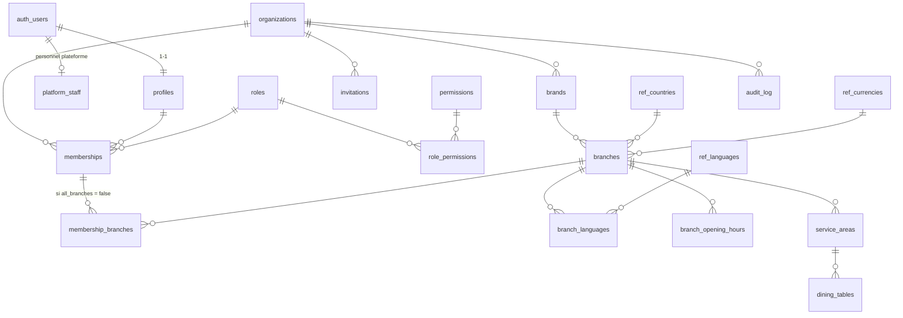

# Resto — Modèle de données

Statut : **Phase 1 détaillée** (migration `001_fondations.sql`) ; domaines
suivants esquissés, détaillés à l'ouverture de chaque phase.

## 1. Conventions

| Sujet | Règle |
|---|---|
| Clés | `id uuid primary key default gen_random_uuid()` ; le client peut fournir l'id (hors ligne) |
| Locataire | `organization_id uuid not null` sur toute ligne métier + `unique (organization_id, id)` sur les parents |
| Liens internes | clés étrangères composites `(organization_id, parent_id) references parent (organization_id, id)` |
| Montants | `*_minor bigint` + `currency char(3)` ; jamais `float`/`double` |
| Taux | `numeric(9,6)` (ex. 19.25 % → `19.250000`) |
| Dates | `timestamptz` (UTC) ; fuseau IANA de l'établissement pour l'affichage et les journées comptables |
| Statuts | `text` + `check (… in (…))` ; un statut par dimension, jamais combinés |
| Suppression | `on delete restrict` pour les données métier ; archivage (`archived_at`) plutôt que suppression ; `cascade` uniquement pour les tables purement dépendantes (ex. liens) |
| Historique | colonnes `created_at`, `created_by`, `updated_at` ; `audit_log` immuable |
| Textes traduisibles du restaurant | table `*_translations (entity_id, locale, champ…)` — jamais de colonnes par langue |
| JSON | réservé aux données non relationnelles (détails d'audit, réponse brute d'un prestataire) |

## 2. Référentiels internationaux

| Table | Source | Contenu |
|---|---|---|
| `ref_countries` | ISO 3166-1 via le projet Debian *iso-codes* (maintenu) | alpha-2 (PK), alpha-3, numérique, nom anglais |
| `ref_currencies` | ISO 4217, liste officielle de l'agence de maintenance (SIX) | code (PK), numérique, **minor_unit**, nom |
| `ref_languages` | BCP 47, liste fermée des langues d'interface activées | code, nom natif, `rtl` |
| fuseaux | `pg_timezone_names` (IANA, intégré à PostgreSQL) | validé par la fonction `app_private.is_valid_timezone` |

Les données de pays et monnaies ne sont **pas** saisies à la main :
`tool/generer_referentiels.dart` télécharge les sources officielles et
produit `supabase/seed/ref_iso.sql` (rejouable : `on conflict do update`).

## 3. ERD — Phase 1 (fondations)

### Tables Phase 1

| Table | Rôle | Points clés |
|---|---|---|
| `profiles` | profil minimal d'un compte | nom affiché, langue, pays ; PII au strict nécessaire |
| `platform_staff` | personnel de la plateforme | rôle `support`/`finance`/`moderation`/`superadmin` ; aucun accès automatique aux données des restaurants |
| `organizations` | locataire | pays, monnaie et langue **par défaut**, statut `active`/`suspended` |
| `roles`, `permissions`, `role_permissions` | catalogue des droits | rôles système non modifiables par les organisations |
| `memberships` | utilisateur ↔ organisation | rôle, `all_branches`, statut `active`/`revoked` ; un seul lien par (organisation, utilisateur) |
| `membership_branches` | restriction à des établissements | clé composite vers `branches` |
| `invitations` | invitation par e-mail | jeton aléatoire **stocké haché**, expiration, usage unique |
| `brands` | marque / restaurant | nom, slug unique global, statut |
| `branches` | établissement | pays, adresse, coordonnées, fuseau IANA, monnaie, langue par défaut, publication |
| `branch_languages` | langues proposées | FK vers `ref_languages` |
| `branch_opening_hours` | horaires | jour ISO 1–7, heures locales, passage de minuit autorisé |
| `service_areas`, `dining_tables` | salle | capacité, statut actif ; le statut d'occupation sera dérivé des commandes (pas stocké en double) |
| `audit_log` | journal immuable | qui, quoi, quand, organisation, avant/après ; aucune mise à jour ni suppression possible |

## 4. Domaines suivants (esquisse)

| Phase | Domaine | Tables principales |
|---|---|---|
| 2 | Menus ✅ (004) | `menu_categories`, `menu_items`, `item_variants`, `modifier_groups`, `modifiers`, `item_modifier_groups`, `item_allergens` + `ref_allergens`, 5 tables `*_translations`, `menu_item_branches` (proposé / disponible), `prices` (variante OU supplément × établissement × canal, période `valid_from`–`valid_to`, jamais modifié ni supprimé) |
| 2 | Commandes ✅ (005) | `orders` (statut open / closed / cancelled, canal, table, numéro du jour, taxe figée, totaux), `order_items` (instantané nom / prix, statut de préparation par ligne), `order_item_modifiers`, `order_events` (immuable), `branch_counters` |
| 2 | Cuisine | `prep_stations`, `kitchen_tickets`, `preparation_tasks` |
| 2 | Caisse / paiements | `cash_registers`, `cash_sessions`, `cash_movements`, `payments` (statut : pending/authorized/confirmed/failed/cancelled), `payment_allocations`, `refunds` |
| 3 | Recettes | `recipes`, `recipe_versions` (validité dans le temps), `recipe_items` (ingrédient ou sous-recette, quantité, unité, perte) |
| 3 | Stocks | `ingredients`, `units`, `unit_conversions`, `stock_locations`, `stock_lots`, `stock_movements` (append-only), `inventory_counts`, `inventory_count_lines` |
| 3 | Achats | `suppliers`, `purchase_orders`, `goods_receipts`, `supplier_invoices`, `supplier_payments` |
| 3 | Finance | `expenses`, `expense_categories`, `tax_profiles`, `tax_rates` (par juridiction, période) |
| 4 | Clients | `customer_addresses`, `favorites`, `reservations`, `reservation_tables` (contrainte d'exclusion anti-chevauchement), `reviews` (vérifiés par commande), `loyalty_accounts`, `loyalty_transactions`, `promotions`, `coupons` |
| 5 | Monétisation | `plans`, `plan_limits`, `subscriptions`, `platform_invoices`, `commission_rules` (historisées), `order_commissions` (règle figée par transaction), `settlements`, `settlement_lines`, `fx_rates` (taux, source, horodatage) |
| 6 | Synchronisation | `devices`, `sync_events` (unique `(device_id, client_event_id)`), `sync_conflicts` |

Les mouvements de stock, paiements, remboursements, mouvements de caisse et
écritures de commission sont **append-only** : corrections par écriture
inverse liée à l'originale.
